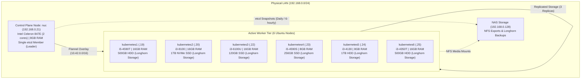
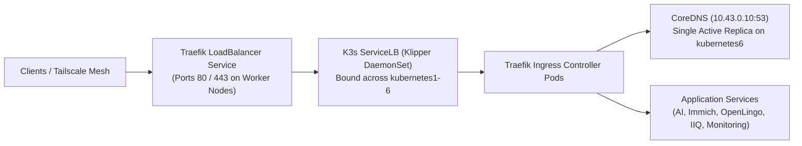
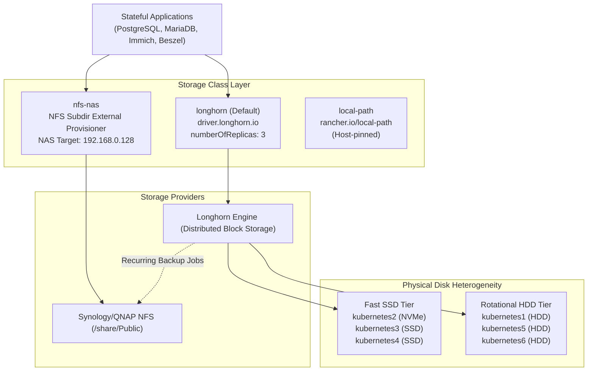

# K3s Homelab Cluster Architecture

This document outlines the architectural topology, data flow, storage model, and networking of the seven-node Ubuntu K3s homelab.

---

## 1. High-Level Cluster Topology

---

## 2. Ingress & Traffic Routing Architecture

---

## 3. Storage Hierarchy & Resilience Model

---

## 4. Single Points of Failure (SPOF) Analysis

1. **Embedded etcd Quorum:**
   - Single voter on `nuc`. If `nuc` suffers hardware or network failure, the Kubernetes API becomes unavailable cluster-wide.
2. **CoreDNS Replica Count:**
   - Single running replica on `kubernetes6`. If `kubernetes6` is rebooted or experiences memory pressure, in-cluster DNS resolution fails for all pods.
3. **Legacy Backup Cron Disruption:**
   - Daily cron job `/usr/local/bin/k3s-backup-to-nas.sh` stopping `k3s.service` on `nuc` every morning at 02:00 UTC.
4. **Storage Latency Bottleneck:**
   - 3-replica Longhorn volumes spanning across both NVMe and spinning HDDs are throttled by the slowest rotational drive write latency.
