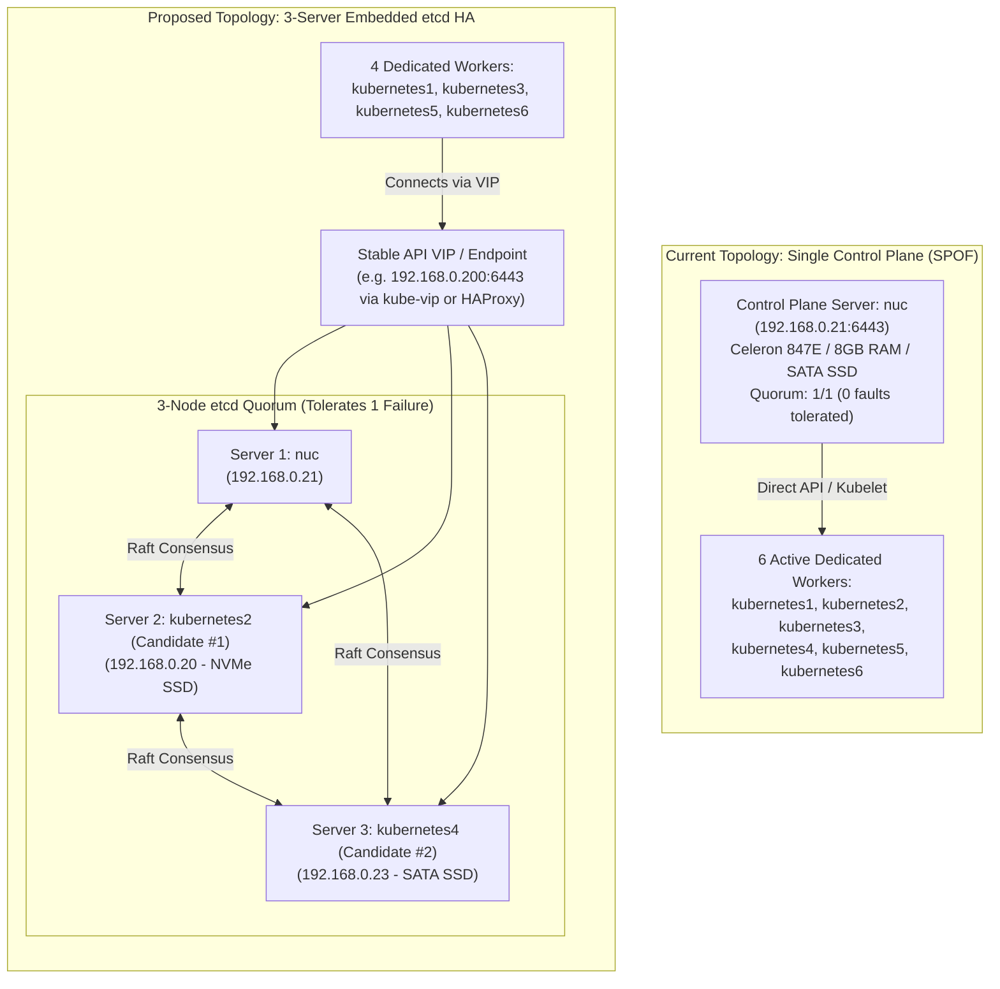

# K3s Control-Plane High-Availability Architecture Proposal

**Document Status:** Architecture Proposal (APPROVAL-GATED — No changes applied)  
**Scope:** Reassessment of single-server single point of failure (SPOF) and 3-server embedded etcd HA roadmap.

---

## 1. Executive Summary & Problem Statement

The live homelab cluster currently operates with **one control-plane server node (`nuc`)** and **six active agent nodes (`kubernetes1` through `kubernetes6`)**.

### Single Point of Failure (SPOF) Analysis
- **Datastore SPOF:** All cluster metadata, CRDs, Longhorn volume attachments, and pod states reside on a single embedded etcd instance running on `nuc`.
- **API Server SPOF:** The Kubernetes API server runs only on `192.168.0.21:6443`. If `nuc` experiences a hardware fault, power loss, or OS crash, cluster management terminates immediately.
- **Hardware Profile Limitation:** `nuc` is powered by an Intel Celeron 847E (1.10 GHz, 2 cores, 2 threads) with 8GB RAM and a 120GB SATA SSD. This CPU has limited headroom during heavy control loops or etcd compactions.

---

## 2. Current vs Proposed Topology Comparison

---

## 3. Server-Node Hardware Selection & Disk Suitability Ranking

Embedded etcd performance is bounded primarily by sequential disk write (fsync) latency and CPU responsiveness. A node backing etcd cannot run on a rotational disk without risking raft heartbeat timeouts and election storms.

### Measured Hardware Ranking Matrix

| Rank | Node Name | IPv4 | CPU Model & Cores | RAM (MB) | Disk Model & Interface | Rotational? | Suitability Assessment |
| :---: | :--- | :--- | :--- | :--- | :--- | :---: | :--- |
| **#1** | **`kubernetes2`** | `192.168.0.20` | Intel Core i3-8100 (4C @ 3.60GHz) | 15,360 | Crucial CT1000P3SSD8 (NVMe) | **No** (0) | **Optimal Candidate #1.** Fast NVMe sequential write speeds (<0.5ms fsync), robust 4-core desktop CPU, 16GB RAM. |
| **#2** | **`kubernetes4`** | `192.168.0.23` | Intel Core i5-4590S (4C @ 3.00GHz) | 7,870 | Samsung MZ7LN256 (SATA SSD) | **No** (0) | **Strong Candidate #2.** Dedicated Samsung SSD with low write latency, 4 high-clock cores, stable desktop chassis. |
| **#3** | **`nuc`** *(Current)* | `192.168.0.21` | Intel Celeron 847E (2C @ 1.10GHz) | 7,865 | Kingston SMS200S3120G (SATA SSD) | **No** (0) | **Current Server 1.** SSD storage is adequate, but CPU is weak. Retained in 3-node quorum to preserve cluster identity. |
| **#4** | **`kubernetes3`** | `192.168.0.22` | Intel Core i3-6100U (2C/4T @ 2.30GHz) | 15,864 | Kingston SM2280S (SATA SSD) | **No** (0) | **Alternate Candidate.** SSD equipped, but laptop form factor introduces thermal throttling and battery-standby risks. |
| — | **`kubernetes1`** | `192.168.0.19` | Intel Core i5-4590T (4C @ 2.00GHz) | 15,889 | Seagate ST500LM000 (Hybrid/HDD) | **Yes** (1) | **DISQUALIFIED for etcd.** Rotational disk causes high fsync latency spikes (>15ms), risking quorum loss. |
| — | **`kubernetes5`** | `192.168.0.24` | Intel Core i3-4130 (2C/4T @ 3.40GHz) | 7,870 | WDC WD10EZEX-21M (HDD) | **Yes** (1) | **DISQUALIFIED for etcd.** Rotational disk. High risk of raft heartbeat drops. |
| — | **`kubernetes6`** | `192.168.0.25` | Intel Core i3-4350T (2C/4T @ 3.10GHz) | 15,893 | Toshiba MQ02ABF0 (HDD) | **Yes** (1) | **DISQUALIFIED for etcd.** Rotational disk. High risk of raft heartbeat drops. |

---

## 4. Quorum Behaviour & Failure Tolerance

In a 3-server embedded etcd cluster:
- **Total Voting Members:** 3 (`N = 3`)
- **Quorum Requirement:** Majority vote: `Q = floor(N/2) + 1 = 2` nodes must be online and communicating.
- **Failure Tolerance:** Exactly 1 server failure tolerated (`F = (N-1)/2 = 1`).
- **Behaviour during 1 Node Outage:** Cluster remains fully operational: API server accepts reads and writes; etcd maintains quorum; workloads schedule normally.
- **Behaviour during 2 Node Outage:** Quorum is lost. The API server transitions to read-only or becomes unresponsive. Workload pods continue running locally under containerd, but no state changes can occur until quorum is restored.

---

## 5. Stable API Registration Endpoint Strategy

Currently, worker nodes connect directly to `https://192.168.0.21:6443`. In a 3-server topology, hardcoding a single node IP re-introduces an API SPOF.

To achieve true HA, a stable endpoint is required:

### Option A: Virtual IP via `kube-vip` (Recommended)
- Deploys `kube-vip` as a DaemonSet or static pod on control-plane nodes.
- Manages an ARP/VIP on the physical LAN (e.g. `192.168.0.200`).
- If the leader server fails, `kube-vip` fails over the IP to another server within 2–5 seconds.

### Option B: External Layer 4 Load Balancer
- An external HAProxy / NGINX instance or firewall load-balances TCP 6443 across the 3 server IPs with health checks.
- Requires external infrastructure maintenance outside the K3s boundary.

### Option C: DNS Round-Robin with Short TTL
- `k3s-api.homelab.local` resolves to all 3 server IPs.
- Simplest to deploy, but client failover depends on client-side retry behaviour.

---

## 6. Migration Prerequisites & Constraints

Before promoting `kubernetes2` and `kubernetes4` to server nodes:

1. **Do Not Execute Without Approval:** This migration involves datastore schema changes and etcd cluster joining.
2. **Longhorn Rebalancing:** `kubernetes2` and `kubernetes4` currently host Longhorn volume replicas. Promoting them to servers means they will host both etcd and storage replicas. Disk I/O prioritization (`ionice`) or reserving dedicated partitions for etcd WAL is recommended.
3. **Cluster Token Recovery Material:** Original cluster join token in `/var/lib/rancher/k3s/server/token` must be present and verified.
4. **Full Datastore Backup:** Verified atomic backup taken and copied off-node to NAS before initiating join commands.
5. **No Existing Server Taints:** Worker workloads running on `kubernetes2` and `kubernetes4` must either be tolerated or gracefully migrated to remaining agents (`kubernetes1`, `kubernetes3`, `kubernetes5`, `kubernetes6`).

---

## 7. Migration Sequence, Interruption & Rollback

### Expected Interruption
- **Control Plane Downtime:** Zero planned downtime during join operations if executed sequentially.
- **Worker Reconfiguration:** Updating worker node agent configs to point to the new VIP requires a rolling restart of `k3s-agent.service` (approx 5–10 seconds per worker node, zero workload interruption).

### High-Level Migration Phases
1. **Pre-flight:** Snapshot etcd and archive server identity on `nuc`.
2. **Deploy VIP:** Establish stable API endpoint (`192.168.0.200`).
3. **Promote Node 2 (`kubernetes2`):** Stop `k3s-agent`, reconfigure systemd unit for `k3s server --server https://192.168.0.200:6443`, join etcd cluster. Validate 2-member etcd health.
4. **Promote Node 3 (`kubernetes4`):** Repeat process for `kubernetes4`. Validate 3-member quorum (`etcdctl member list`).
5. **Update Remaining Workers:** Update `K3S_URL` on `kubernetes1`, `kubernetes3`, `kubernetes5`, and `kubernetes6` to point to `https://192.168.0.200:6443`.

### Rollback Plan
If etcd join fails or cluster quorum destabilizes during migration:
1. Stop `k3s` on promoted candidate nodes.
2. Remove failed members via `etcdctl member remove <MEMBER_ID>` from `nuc`.
3. If datastore corruption occurs, restore single-server etcd state on `nuc` using `k3s server --cluster-reset --cluster-reset-restore-path=<SNAPSHOT>`.
4. Revert candidate nodes back to agent role.
