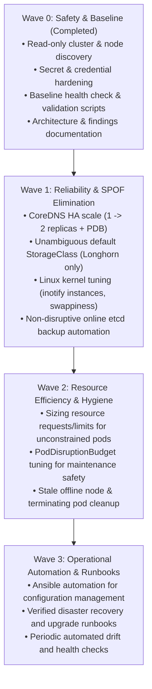

# K3s Homelab Optimisation & Remediation Plan

This plan establishes a structured, phased approach to improving reliability, storage resilience, networking, and resource efficiency across the seven-node Ubuntu cluster.

---

## Phased Implementation Roadmap

---

## Wave 0: Safety & Discovery (Completed)

- [x] **Secret Protection:** Hardened `.gitignore` to prevent credential, token, key, and raw log leakage.
- [x] **Cluster Discovery:** Identified the 7 active Ubuntu nodes (`nuc` server, `kubernetes1`–`kubernetes6` agents).
- [x] **Datastore Identification:** Confirmed single-voter embedded etcd on `nuc` (`nuc-1e55bd21`).
- [x] **Baseline Health Validation:** Automated testing via `validate-cluster.sh`, `validate-dns.sh`, and `validate-network.sh`.
- [x] **Redaction Tooling:** Implemented `scripts/redact-output.sh` for non-secret diagnostics.

---

## Wave 1: Reliability & High Availability

### 1. CoreDNS High Availability
- **Problem:** CoreDNS has only 1 active replica on `kubernetes6`. Any restart or node drain breaks DNS cluster-wide.
- **Solution:** Apply `kubernetes/monitoring/coredns-ha-patch.yaml` to scale to 2 replicas with `topologySpreadConstraints` and a PodDisruptionBudget.
- **Validation:** Confirm 2 pods in `Running` state across distinct worker nodes.

### 2. Default StorageClass Disambiguation
- **Problem:** Both `longhorn` and `local-path` claim to be the default StorageClass.
- **Solution:** Apply `kubernetes/storage/default-storageclass-fix.yaml` to remove default annotation from `local-path`.
- **Validation:** Confirm only `longhorn` has `is-default-class: "true"`.

### 3. Linux Kernel inotify & Swappiness Tuning
- **Problem:** `fs.inotify.max_user_instances = 128` is at risk of exhaustion under container workloads; `vm.swappiness = 60` triggers premature swapping.
- **Solution:** Execute Ansible playbook `ansible/playbooks/node-tune.yaml` to apply `fs.inotify.max_user_instances = 8192` and `vm.swappiness = 10`.
- **Validation:** Run `sysctl fs.inotify.max_user_instances vm.swappiness` across all hosts.

### 4. Non-Disruptive Online etcd Backup
- **Problem:** Existing root crontab on `nuc` stops K3s at 02:00 UTC daily to back up an obsolete 0-byte SQLite database.
- **Solution:** Replace crontab on `nuc` with `ansible/roles/k3s_server/tasks/main.yaml` (`/usr/local/bin/k3s-etcd-safe-backup.sh`).
- **Validation:** Run `./scripts/verify-etcd-snapshot.sh` to confirm snapshot creation without K3s service restart.

---

## Wave 2: Resource Efficiency & Placement

### 1. Workload Resource Baselines
- Apply conservative requests and limits to unconstrained platform workloads:
  - `kube-system/traefik`: `cpu: 100m / 500m`, `memory: 128Mi / 512Mi`
  - `kube-system/local-path-provisioner`: `cpu: 10m / 100m`, `memory: 32Mi / 128Mi`
  - `default/nfs-provisioner`: `cpu: 50m / 200m`, `memory: 64Mi / 256Mi`
  - `argocd/*`: Add requests based on measured 10-day usage.

### 2. PodDisruptionBudget Refinement
- Review PDBs that set `maxUnavailable: 0` on single-replica workloads (e.g. `media/audiobookshelf`, `iiqstack/activemq`), which permanently block graceful node maintenance drains.

---

## Wave 3: Operational Automation & Disaster Recovery

### 1. Configuration Drift Detection
- Run automated drift detection weekly using Ansible audit playbook `ansible/playbooks/audit.yaml`.

### 2. Multi-Server Control Plane Readiness (Approval Required)
- If multi-node control plane HA is desired, migrate `kubernetes2` (i3-8100 NVMe) and `kubernetes4` (i5-4590S SSD) to K3s servers to achieve a 3-node etcd quorum.
