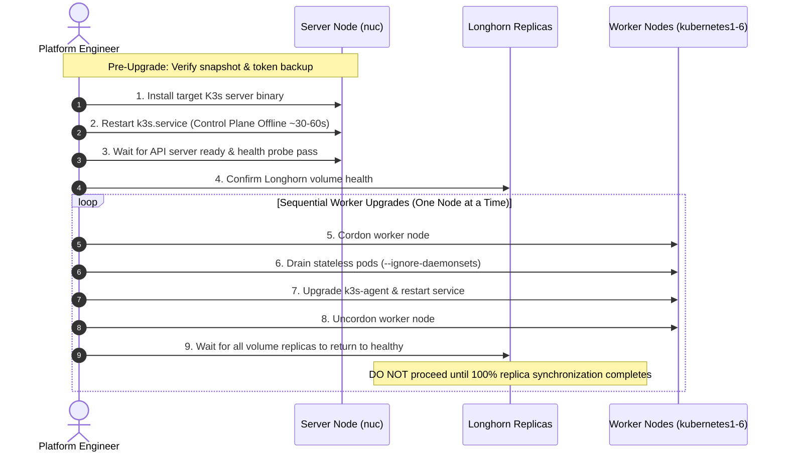

# Controlled K3s Upgrade Runbook

**Document Description:** Controlled K3s upgrade runbook with documented control-plane interruption for the current single-server topology.

---

## 1. Architecture Context & Service Interruption Notice

> [!WARNING]
> **Documented Control-Plane Interruption Notice**  
> The current homelab cluster operates with a **single control-plane server node (`nuc`)**.  
> Upgrading the K3s server binary on `nuc` requires restarting `k3s.service`. During this service restart:
> - The **Kubernetes API Server (`https://192.168.0.21:6443`) is unavailable**.
> - The Kubernetes controller-manager, scheduler, and embedded etcd are temporarily unreachable.
> - `kubectl`, ArgoCD, and automated deployment pipelines cannot communicate with the cluster.
> - **Data-plane workloads on worker nodes (`kubernetes1`–`kubernetes6`) continue execution** under containerd, but cannot schedule new pods, mutate PVCs, or respond to node failures until the control plane restarts.
> 
> Therefore, this procedure is **controlled but not zero-downtime** for cluster management.

---

## 2. Baseline Running Versions

| Component | Measured Live Version | Upgrade Channel / Target |
| :--- | :--- | :--- |
| **K3s Control Plane** | `v1.34.6+k3s1` | Stable Channel |
| **Kubernetes Core API** | `v1.34.6` | Stable Channel |
| **Containerd Runtime** | `2.2.2-bd1.34` | Bundled with K3s binary |
| **Control Plane Node OS** | Ubuntu 24.04.2 LTS (`nuc`) | Ubuntu 24.04 LTS HWE |
| **Worker Node OS** | Ubuntu 24.04.2 LTS (`kubernetes1`–`6`) | Ubuntu 24.04 LTS HWE |
| **Persistent Storage** | Longhorn `v1.8.1` | Managed via `longhorn-system` |

---

## 3. Pre-Upgrade Safeguards & Prerequisites

Before initiating any binary upgrade or reboot, complete and verify the following:

1. **Pre-Upgrade Datastore Snapshot:**
   Execute a verified online etcd snapshot:
   ```bash
   ./scripts/verify-etcd-snapshot.sh
   ```
   Confirm that a fresh snapshot exists in `/var/lib/rancher/k3s/server/db/snapshots/` and passes the size validation (>10MB).

2. **Server-Token & Identity Recovery Material Verification:**
   Verify that server recovery assets (`/var/lib/rancher/k3s/server/token`, `tls/`, `cred/`, and `/etc/rancher/k3s/`) are safely archived off-node to NAS storage (`192.168.0.128:/Public/backups/k3s`).
   *Without the original server token and CA certificates, worker nodes cannot rejoin a rebuilt or rolled-back server.*

3. **Version-Specific Rollback Snapshot:**
   Label or save a dedicated rollback snapshot explicitly named with the current version tag:
   ```bash
   # On nuc (via secure askpass / stdin execution)
   k3s etcd-snapshot save --name "pre-upgrade-v1.34.6-rollback"
   ```

4. **Longhorn Storage Health Check:**
   Verify that all 39 attached production volumes report `healthy` with 3 active replicas:
   ```bash
   kubectl -n longhorn-system get volumes.longhorn.io -o custom-columns=NAME:.metadata.name,ROBUSTNESS:.status.robustness,STATE:.status.state | grep -v healthy
   ```
   *(Only the intentionally detached legacy volume `pvc-1a05dbf3-c9eb-48d3-8b02-9a39645a884e` should appear as detached/unknown).*

5. **API & Deprecation Audit:**
   Review upstream Kubernetes deprecation notices for the target minor version to ensure no custom resources or manifests use removed API versions.

---

## 4. Upgrade Execution Sequencing



### Phase 1: Control Plane Upgrade (`nuc`)
1. Connect to `nuc` and execute the official K3s installer specifying the target version:
   ```bash
   INSTALL_K3S_VERSION="<TARGET_VERSION>" sh -s - server
   ```
2. Monitor service startup:
   ```bash
   sudo systemctl status k3s --no-pager
   ```
3. Validate API server availability from the workstation:
   ```bash
   kubectl get nodes -o wide
   kubectl cluster-info
   ./scripts/validate-dns.sh
   ```

### Phase 2: Sequential Worker Node Upgrades (`kubernetes1` to `kubernetes6`)

> [!CAUTION]
> **Strict Serialization Mandate:**  
> Worker nodes must be upgraded and rebooted strictly **one at a time**. Longhorn 3-replica volumes require a minimum quorum of online replicas. Upgrading multiple workers concurrently causes replica loss, volume degradation, and filesystem I/O errors.

For each worker node (`W` in `kubernetes1` through `kubernetes6`):

1. **Cordon the worker node:**
   ```bash
   kubectl cordon "$W"
   ```
2. **Drain stateless workloads:**
   ```bash
   kubectl drain "$W" --ignore-daemonsets --delete-emptydir-data --force --grace-period=60
   ```
3. **Upgrade `k3s-agent` on the target worker:**
   Connect via SSH and apply the agent upgrade installer pointing to `https://192.168.0.21:6443`.
4. **Uncordon the worker node:**
   ```bash
   kubectl uncordon "$W"
   ```
5. **Post-Node Workload Validation:**
   Wait for all pods on `$W` to reach `Running` state and verify replica re-synchronization:
   ```bash
   kubectl get pods -A --field-selector spec.nodeName="$W"
   kubectl -n longhorn-system get replicas.longhorn.io -l longhornnode="$W"
   ```
   Do not proceed to the next worker until zero volumes remain in `degraded` or `rebuilding` status.

---

## 5. Explicit Stopping Conditions

Immediately halt the upgrade sequence if any of the following occur:

1. **API Server Recovery Timeout:** `k3s.service` on `nuc` fails to respond to `kubectl cluster-info` within 120 seconds of binary installation.
2. **etcd Consistency Error:** The journal logs `etcdserver: publish error: etcdserver: request timed out` or database corrupted errors.
3. **Longhorn Volume Fault:** Any attached persistent volume enters `faulted` status or reports read-only filesystem errors.
4. **DaemonSet Crashlooping:** Core networking pods (`flannel`, `registry-fixer`, `svclb-traefik`) enter `CrashLoopBackOff`.
5. **Replica Synchronization Stalling:** Longhorn replica rebuild fails to progress or exceeds 15 minutes after worker uncordon.

---

## 6. Rollback Procedure

If stopping conditions are triggered during Phase 1 (server upgrade):

1. **Downgrade K3s Server Binary:**
   Re-install the previous known-good binary version (`v1.34.6+k3s1`):
   ```bash
   INSTALL_K3S_VERSION="v1.34.6+k3s1" sh -s - server
   ```
2. **Restore etcd Datastore (if corrupted):**
   If the datastore failed to start or suffered schema corruption:
   ```bash
   sudo systemctl stop k3s
   sudo k3s server --cluster-reset --cluster-reset-restore-path=/var/lib/rancher/k3s/server/db/snapshots/pre-upgrade-v1.34.6-rollback
   sudo systemctl start k3s
   ```
3. **Validate Restored Cluster State:**
   ```bash
   ./scripts/validate-cluster.sh
   ```
